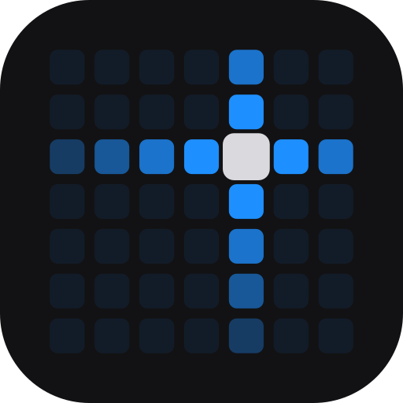

<h1 align="center">TouchFx</h1>

<b>Music-reactive LED light shows, made on your Android phone.</b>

TouchFx listens to music through the microphone or from apps playing on the phone, or follows a
beat you tap. It turns that into real-time effects and streams them over Wi‑Fi to
[WLED](https://kno.wled.ge/) controllers at 60 frames per second: LED strips, groups of devices and
LED matrices. No PC needed.

> Unofficial project, not affiliated with or endorsed by the LedFx or WLED teams.

## Highlights

- **62 effects:** LedFx's strip and matrix effects, 10 from WLED, and TouchFx's own (Segment Chase,
  Effect Chase, Blend), with **110 LedFx presets**.
- **Groups and matrices:** combine devices or parts of them into one light; side-by-side panels.
- **Scenes, hold-to-play scenes and playlists**, plus an **XY pad** to change running effects live.
- **Audio:** microphone, phone audio or **tap tempo**; silence threshold; kick and tempo tracking.
- **WLED:** automatic discovery, DDP streaming, the WLED web page inside the app.
- **Backup and restore** of everything as a JSON file.
- A dark, mixer-style interface.

The full list is in [docs/FEATURES.md](docs/FEATURES.md).

## Install

Install `TouchFx-<version>.apk` on a phone with **Android 10 or newer** (allow installing from that
source when Android asks).

## Quick start

1. Open TouchFx and allow the **microphone** and **notification** permissions.
2. On the **Lights** tab, the *Phone preview* strip already reacts to sound.
3. On the **Devices** tab, tap **Add device** to find WLED controllers on your Wi‑Fi, or enter an IP.
4. Tap a light to pick an **effect**, **presets**, **colours** and **settings**.
5. On the **Audio** tab, choose **Mic**, **Phone** (music playing on the phone) or **Tap**.

## Documentation

| | |
|---|---|
| [Features](docs/FEATURES.md) | Everything TouchFx can do, all effects |
| [Architecture](docs/ARCHITECTURE.md) | How it works, data model, code map |
| [Development](docs/DEVELOPMENT.md) | Building, testing, releasing, signing, tools |
| [Changelog](docs/CHANGELOG.md) | What changed in each version |
| [Credits and licences](docs/CREDITS.md) | LedFx, WLED, LedFx Mobile, FastLED |
| [AGENTS.md](AGENTS.md) | Notes for coding agents and contributors |

## Building

JDK 17–21 and the Android SDK (platform 35): `./gradlew testDebugUnitTest assembleDebug`.
Details, release signing and the preset tool are in [docs/DEVELOPMENT.md](docs/DEVELOPMENT.md).

## Credits and licence

TouchFx stands on three projects:

- [**LedFx Mobile**](https://github.com/mahatosourav00/ledfx-mobile) by Sourav Mahato: the native
  Android app TouchFx is a fork of.
- [**LedFx**](https://github.com/LedFx/LedFx) by the LedFx developers (GPL-3.0): effects, setting
  names and built-in presets.
- [**WLED**](https://github.com/wled/WLED) by Christian Schwinne and the WLED contributors
  (EUPL-1.2): ten ported effects; its helpers derive from [FastLED](https://github.com/FastLED/FastLED) (MIT).

TouchFx is licensed under the **GNU General Public License v3.0**, see [LICENSE](LICENSE). Details,
effect authors and licence notices: [docs/CREDITS.md](docs/CREDITS.md).
